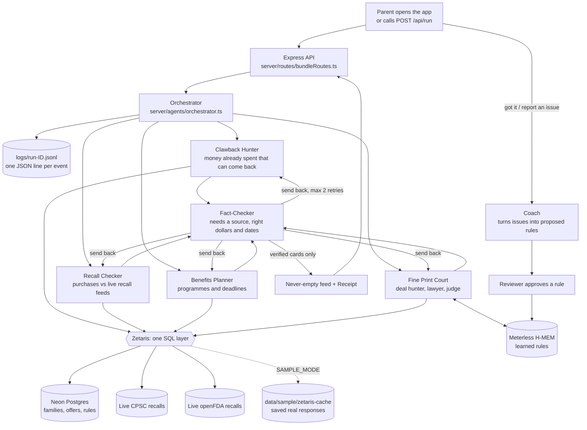

# Architecture

Bundle is a small team of agents. Each one is a separate step in `server/agents/`, and the Fact-Checker can send work
back or drop it. Everything the agents read goes through one SQL door (Zetaris).

## Agents and who can block whom

| Agent | File | Job | Can block or retry? |
|---|---|---|---|
| Orchestrator | `server/agents/orchestrator.ts` | Runs the agents side by side, survives any one failing, builds the feed | Yes: keeps going and shows a banner when a source fails |
| Clawback Hunter | `clawback.ts` | Finds FSA/HSA-eligible spend, price-adjustment refunds, daycare for the Dependent Care FSA | Revises when the Fact-Checker sends it back |
| Recall Checker | `recall.ts` | Joins purchases to recall feeds through Zetaris, then confirms the match | Revises when sent back |
| Benefits Planner | `benefits.ts` | Likely benefits and deadlines from the child's birth or due date | Revises when sent back |
| Fine Print Court | `finePrintCourt.ts` | Deal hunter proposes, lawyer attacks fine print, judge rules (max 5 offers per run) | **Yes: rejects offers**, including those matching a learned rule |
| Fact-Checker | `factChecker.ts` | Every card needs a source, correct amount and date | **Yes: sends back (max 2 retries), then drops the card and logs the drop** |
| Coach | `coach.ts` | Turns parent issue reports into proposed rules | Proposes only; a reviewer approves |
| Scout (script) | `scripts/scout.ts` | Reads 3 saved pages and proposes benefit rows; wrong rows are rejected | Fact-Checker rejects rows not on the page |

## Folder map (to the hackathon's suggested layout)

| Suggested | Here |
|---|---|
| `app/agents/` | `server/agents/` |
| `app/orchestration/` | `server/agents/orchestrator.ts`, `server/bundleDeps.ts` |
| `app/adapters/` (zetaris, meterless, sample data) | `server/adapters/zetaris.ts`, `server/adapters/memory.ts`, `server/adapters/llm.ts`, `data/sample/` |
| `data/sample/` | `data/sample/` |
| `input_examples/` | `input_examples/` |
| `output_examples/` | `output_examples/` |
| `logs/` | `logs/` (live runs are git-ignored; saved examples are in `logs/sample/`) |
